<p align="center"></p>

# deSIDuous User Manual

Version 1.02

deSIDuous is a software instrument that recreates the sound chip of the Commodore 64: the MOS 6581 and its later revision, the 8580, known as the **SID** (Sound Interface Device). Instead of imitating the SID's sound with ordinary synth building blocks, deSIDuous runs a cycle-exact emulation of the chip (reSIDfp) and plays it by writing the chip's real registers, the same way a C64 music program does.

The SID's quirks come from the emulated chip itself: combined waveforms, ring modulation, hard sync, the envelope bugs, and the very different filters of the two chip models.

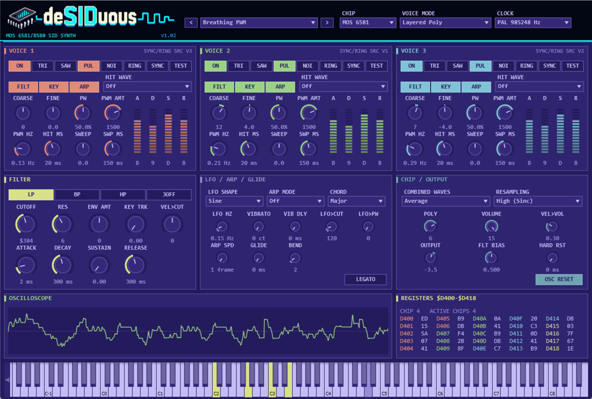

## Contents

1. [Installation](#1-installation)
2. [Quick start](#2-quick-start)
3. [How the SID works](#3-how-the-sid-works)
4. [The header bar](#4-the-header-bar)
5. [Voice panels](#5-voice-panels)
6. [Filter](#6-filter)
7. [LFO, arpeggio and glide](#7-lfo-arpeggio-and-glide)
8. [Chip and output](#8-chip-and-output)
9. [Oscilloscope and register monitor](#9-oscilloscope-and-register-monitor)
10. [Voice modes](#10-voice-modes)
11. [Sound design recipes](#11-sound-design-recipes)
12. [Factory presets](#12-factory-presets)
13. [MIDI reference](#13-midi-reference)
14. [CPU usage](#14-cpu-usage)
15. [Troubleshooting](#15-troubleshooting)
16. [Parameter reference](#16-parameter-reference)

---

## 1. Installation

Download the zip for your system from the [Releases page](https://github.com/squibsy/deSIDuous/releases/latest). Each zip contains a single `deSIDuous.vst3` plugin.

| System | Copy `deSIDuous.vst3` to |
|---|---|
| Windows 10/11 (64-bit) | `C:\Program Files\Common Files\VST3` |
| macOS 10.13 or later (Apple Silicon and Intel) | `/Library/Audio/Plug-Ins/VST3` (all users) or `~/Library/Audio/Plug-Ins/VST3` (just you) |
| Linux (64-bit) | `~/.vst3` |

Then open your DAW and rescan plugins. deSIDuous appears as an **instrument** from **Bananalytics**.

**macOS:** the plugin is not notarised by Apple, so macOS may refuse to load it. After copying, open Terminal and run this once (change the path if you installed to `~/Library`):

```bash
xattr -dr com.apple.quarantine /Library/Audio/Plug-Ins/VST3/deSIDuous.vst3
```

## 2. Quick start

1. Add deSIDuous to an instrument track in your DAW.
2. Pick a sound from the **preset menu** in the header, or step through presets with the **<** and **>** buttons.
3. Play from your MIDI keyboard, or click the on-screen keyboard at the bottom of the window.
4. To tweak a preset, start with a voice's **waveform buttons** (TRI, SAW, PUL, NOI), its **ADSR** bars, and the filter's **CUTOFF** and **RES** knobs.

Hover over any control to see a tooltip explaining what it does. Your settings are saved with your DAW project.

## 3. How the SID works

A short tour of the chip helps make sense of the controls.

- **Three voices.** The SID has exactly three oscillators. Each has its own waveform, pitch, pulse width and envelope.
- **Four waveforms per voice:** triangle, sawtooth, pulse and noise. You can switch on more than one at once. The chip then combines them in its own odd way (it doesn't simply mix them), which gives the famous thin, metallic "combined waveforms".
- **One shared filter.** Every voice can be routed through a single resonant filter with low-pass, band-pass and high-pass outputs. The 6581's filter is warm and distorted and differs from chip to chip; the 8580's is cleaner and closer to textbook.
- **Envelopes with fixed steps.** Each voice's attack, decay, sustain and release use 16 fixed rates, from 2 ms up to 24 seconds.
- **No per-voice volume.** The only volume control is a 4-bit master volume for the whole chip. A voice's loudness comes from its envelope's sustain level.
- **Ring mod and sync link the voices.** Voice 1 can be ring-modulated or synced by voice 3, voice 2 by voice 1, and voice 3 by voice 2.

Classic C64 music made rich sounds from these limits with tricks: rapid arpeggios to fake chords, fast waveform switching for drums, and pulse width sweeps for movement. deSIDuous adds those tricks as controls (see [Voice panels](#5-voice-panels) and [LFO, arpeggio and glide](#7-lfo-arpeggio-and-glide)).

## 4. The header bar


| Control | What it does |
|---|---|
| **< / preset menu / >** | Choose a factory preset. The menu is grouped by category. Choosing a preset resets every control to its default and then applies the preset. |
| **CHIP** | **MOS 6581**: the original chip. Gritty, warm filter that varies between chips; combined waveforms are quiet. **MOS 8580**: the later revision. Cleaner, more precise filter with strong resonance; combined waveforms are louder. |
| **VOICE MODE** | How MIDI notes are mapped onto the SID's voices. See [Voice modes](#10-voice-modes). |
| **CLOCK** | **PAL** (985,248 Hz, European C64s) or **NTSC** (1,022,730 Hz, American C64s). Pitch is corrected automatically. This also sets the arpeggio's frame rate: 50 Hz for PAL, 60 Hz for NTSC. |

## 5. Voice panels

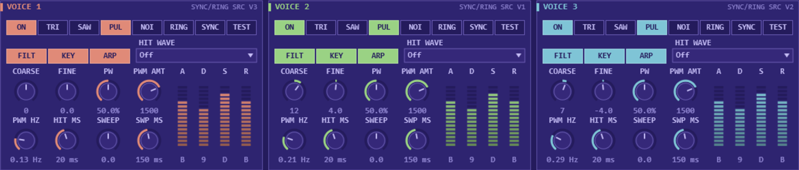

There is one panel per voice, colour-coded red, green and blue. The label at the top right (for example **SYNC/RING SRC V3**) shows which voice this one is synced or ring-modulated by.

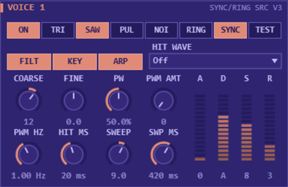

### Top row: waveform and control bits

These are the bits of the voice's control register.

| Button | What it does |
|---|---|
| **ON** | Plays this voice. A voice that is off still runs its oscillator at the played pitch, silently, so it can drive sync or ring mod on its neighbour. |
| **TRI** | Triangle wave: soft and flute-like. |
| **SAW** | Sawtooth wave: bright and buzzy. |
| **PUL** | Pulse wave: hollow to nasal depending on **PW** (pulse width). |
| **NOI** | Noise: for drums, wind and explosions. Its pitch sets how bright the noise sounds. |
| **RING** | Ring modulation: replaces this voice's triangle with a ring-modulated version, using the source voice's pitch. Needs **TRI** on. Gives bell and metallic tones. |
| **SYNC** | Hard sync: restarts this voice's waveform every cycle of the source voice. The source sets the pitch you hear, and this voice's own pitch sets the tone. |
| **TEST** | The SID's test bit: holds the oscillator at zero, and resets a stuck noise generator if held on for a while. Mostly silent; included for completeness and experiments. |

Turning on more than one waveform gives a **combined waveform**. See the [scope pictures](#combined-waveforms) below.

### Second row

| Control | What it does |
|---|---|
| **FILT** | Routes this voice through the filter. |
| **KEY** | Key tracking. When off, the voice ignores the key you play and always sounds at middle C (MIDI note 60) plus **COARSE**. Use this for drums. |
| **ARP** | Applies the arpeggio to this voice (when the arpeggio is on). |
| **HIT WAVE** | Plays a different waveform for the first few milliseconds of each note, then switches to the main waveform. This is the classic SID trick for drum and pluck attacks, such as a burst of noise before a pulse tone. |

### Knobs

| Knob | What it does |
|---|---|
| **COARSE** | Pitch offset in semitones (-48 to +48). |
| **FINE** | Fine tune in cents (-100 to +100). Detune voices slightly for a fatter sound. |
| **PW** | Pulse width: 0 to 4095, the chip's 12-bit register. 50% (2048) is a square wave; values near 0% or 100% sound thin. |
| **PWM AMT** | How far the pulse width sweeps up and down. |
| **PWM HZ** | How fast the pulse width sweeps. Slow sweeps on several voices are the classic C64 pad sound. |
| **HIT MS** | How long the hit wave plays. |
| **SWEEP** | Pitch sweep: how many semitones above (positive) or below (negative) the note each note starts at. It then slides to the note, fast at first. |
| **SWP MS** | How long the pitch sweep takes. |

### ADSR

The four bars on the right are the voice's envelope. Each has 16 steps (0 to F in hex), exactly like the chip. Drag a bar up or down; hover to see the time.

| Value | 0 | 1 | 2 | 3 | 4 | 5 | 6 | 7 | 8 | 9 | A | B | C | D | E | F |
|---|---|---|---|---|---|---|---|---|---|---|---|---|---|---|---|---|
| **Attack** | 2 ms | 8 ms | 16 ms | 24 ms | 38 ms | 56 ms | 68 ms | 80 ms | 100 ms | 250 ms | 500 ms | 800 ms | 1 s | 3 s | 5 s | 8 s |
| **Decay / Release** | 6 ms | 24 ms | 48 ms | 72 ms | 114 ms | 168 ms | 204 ms | 240 ms | 300 ms | 750 ms | 1.5 s | 2.4 s | 3 s | 9 s | 15 s | 24 s |

**Sustain** is a level from 0 (silent) to F (full). Because the SID has no per-voice volume, sustain is the way to balance voices against each other.

## 6. Filter

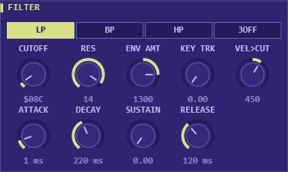

The SID has one filter shared by all three voices. Only voices with **FILT** switched on pass through it; the others go straight to the output.

| Control | What it does |
|---|---|
| **LP / BP / HP** | Low-pass, band-pass and high-pass. You can combine them: LP + HP gives a notch. With none on, routed voices are silenced. |
| **3OFF** | Disconnects voice 3 from the output (when voice 3 isn't routed through the filter). Useful when voice 3 is only a sync or ring source. |
| **CUTOFF** | The chip's 11-bit cutoff register (0 to 2047, shown in hex). On the **8580**, cutoff rises roughly evenly with the value. On the **6581**, the response is uneven: low values change the sound little, and most of the movement happens higher up. |
| **RES** | Resonance, 0 to 15. The 8580 can get very resonant; the 6581 is gentler but adds distortion. |
| **ENV AMT** | How far the filter envelope moves the cutoff, in register units (negative values sweep down). |
| **ATTACK / DECAY / SUSTAIN / RELEASE** | The filter envelope. It restarts on each new note. |
| **KEY TRK** | Raises the cutoff for higher notes, so the tone stays even across the keyboard. |
| **VEL>CUT** | Velocity to cutoff: harder playing opens the filter (negative values close it). |

The filter's character also depends on **FLT BIAS** in the Chip / Output panel. In Layered Poly mode each note has its own chip, so each note gets its own filter and filter envelope.

## 7. LFO, arpeggio and glide

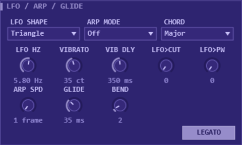

### LFO

One shared LFO (low-frequency oscillator) for vibrato and movement.

| Control | What it does |
|---|---|
| **LFO SHAPE** | Triangle, Sine, Square, Saw Down or Random (a new random value each cycle). |
| **LFO HZ** | Speed, 0.05 to 30 Hz. |
| **VIBRATO** | LFO to pitch, in cents. Up to 1200 cents (an octave) for sirens. The mod wheel adds up to 100 cents on top. |
| **VIB DLY** | Vibrato delay: vibrato fades in this long after each note starts, like a singer. |
| **LFO>CUT** | LFO to filter cutoff (wah and wobble). |
| **LFO>PW** | LFO to every voice's pulse width. |

### Arpeggio

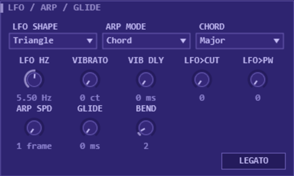

On the C64, chords were usually faked by cycling one voice through the chord notes very fast. deSIDuous has this built in.

| Control | What it does |
|---|---|
| **ARP MODE** | **Off**. **Chord**: every note you play cycles through the chosen chord shape. **Held Notes**: cycles through the keys you're holding (Layered Poly mode only; all notes go to one chip). |
| **CHORD** | The chord shape: Octave, Major, Minor, Major 7, Minor 7, Dom 7, Sus 4, Power, Diminished, Two Octaves, Minor Add9 or Fifths. |
| **ARP SPD** | Step length in video frames, like a C64 tracker. 1 frame is 50 steps per second on PAL (60 on NTSC); 2 frames is half that, and so on up to 16. |

Only voices with **ARP** on follow the arpeggio. In Held Notes mode, voices with **ARP** off play the lowest held note instead, which is handy for a bass under the arpeggio.

### Glide

| Control | What it does |
|---|---|
| **GLIDE** | Portamento time: the pitch slides from the previous note to the new one. |
| **LEGATO** | With Polyphony set to 1 (or in MIDI Ch 1-3 mode), overlapping notes slide without restarting the envelope. Releasing a key returns to the previous held note. |
| **BEND** | Pitch bend range in semitones (0 to 24). |

## 8. Chip and output

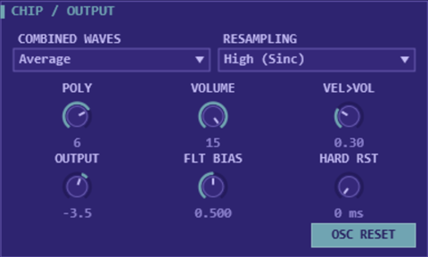

| Control | What it does |
|---|---|
| **COMBINED WAVES** | How strong combined waveforms are: **Average**, **Weak** or **Strong**. Real chips differ here. |
| **RESAMPLING** | **High (Sinc)** gives the cleanest sound. **Fast (Decimate)** is a simpler method with more aliasing. It saves surprisingly little CPU, because most of the cost is the chip emulation itself. |
| **POLY** | How many notes can play at once in Layered Poly mode (1 to 8). Each note uses a whole SID chip. Set it to 1 for a monophonic lead or bass. |
| **VOLUME** | The SID's 4-bit master volume (0 to 15). |
| **VEL>VOL** | How much velocity affects the volume register. On the 6581, volume changes make a small click, just like the real chip. |
| **OUTPUT** | Final output gain in dB (-24 to +12). Presets use this to match their levels. |
| **FLT BIAS** | Shifts the filter's response curve. Real SID chips vary a lot; 0.5 is typical. Lower values make the 6581 darker. |
| **HARD RST** | Hard restart: briefly clears the envelope before each note (0 to 40 ms). The SID has a known envelope bug where a note sometimes starts late or quietly. C64 composers worked around it this way, at the cost of a short delay. |
| **OSC RESET** | Restarts each voice's oscillator at the start of each note, so every note begins the same way. Adds about 1 ms of delay. |

## 9. Oscilloscope and register monitor

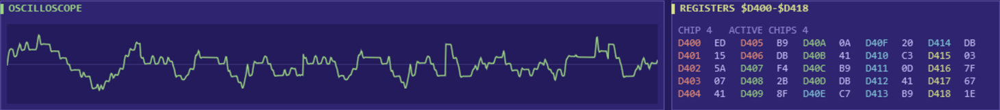

- **OSCILLOSCOPE** shows the plugin's output waveform.
- **REGISTERS $D400-$D418** shows the 25 SID registers exactly as deSIDuous writes them, in hex, for the chip that played most recently. They're colour-coded by voice, with the filter and volume registers in yellow. **ACTIVE CHIPS** shows how many chips are currently sounding.

### Combined waveforms

What the basic waveforms and one combination look like on the scope:

| | |
|---|---|
| Sawtooth  | Triangle 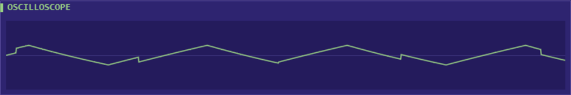 |
| Pulse (square, 50%) 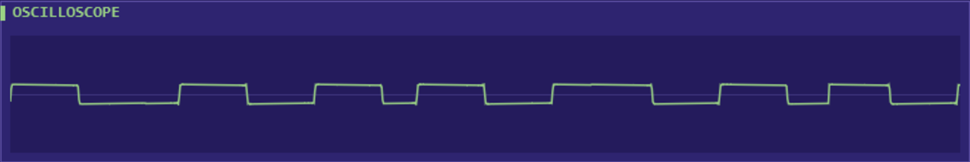 | Noise through the band-pass filter 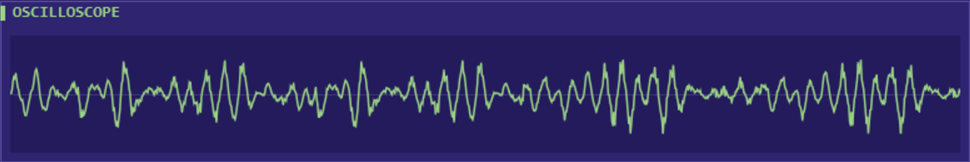 |
| Triangle + pulse, combined (8580) 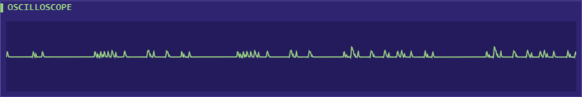 | |

The triangle + pulse combination produces only narrow spikes. That is how the real chip behaves, and it's why combined waveforms sound thin and bright.

## 10. Voice modes

Set in the header's **VOICE MODE** menu.

**Layered Poly** (default). Every note gets its own complete SID chip, with all three voices playing that note through their own settings. Up to 8 chips (set by **POLY**). This is the most flexible mode: one patch can stack three voices with different waveforms, tunings and envelopes, and each note has its own filter.

**Paraphonic (3 notes).** One SID chip, like a real C64. Each note you play goes to the next free voice (among voices with **ON** switched on), so at most three notes sound at once. Each voice keeps its own sound settings, so a chord can mix waveforms. The filter is shared, as on the real chip.

**MIDI Ch 1-3.** One chip. MIDI channel 1 plays voice 1, channel 2 plays voice 2 and channel 3 plays voice 3, each one note at a time. Other channels are ignored. This is how C64 tunes are structured, so it suits tracker-style composing: put bass, lead and arpeggio on three MIDI channels.

## 11. Sound design recipes

### Hard sync lead or bass


1. On voice 1, choose **SAW** and turn **SYNC** on.
2. Leave voice 3 switched **off**. It still runs silently at the played pitch and acts as the sync source.
3. Raise voice 1's **COARSE** (for example +12 to +19). This sets the tone; voice 3 sets the pitch you hear.
4. Add a **SWEEP** (for example +9 over 400 ms) for the classic sync "growl".

### Ring-mod bell

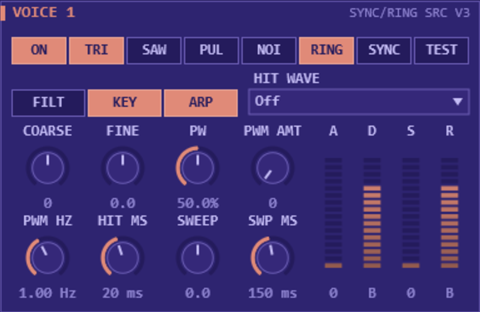

1. On voice 1, choose **TRI** and turn **RING** on.
2. Set voice 3 to an odd interval, for example **COARSE** +19 and **FINE** +27, and leave it **off**.
3. Use a fast attack, long decay and zero sustain (A 0, D B, S 0, R B).

### Drum hit

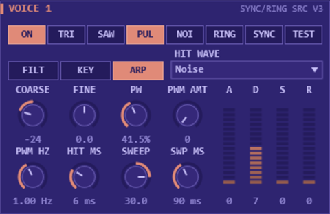

1. Choose **PUL** (or **TRI**) as the main waveform.
2. Set **HIT WAVE** to **Noise** for about 6 ms, to give the click at the start.
3. Add a big downward **SWEEP** (for example +30 over 90 ms).
4. Turn **KEY** off so every key plays the same drum, and use **COARSE** to tune it.
5. Use zero sustain and release, with decay around 7.

Snares and hi-hats work the same way with **NOI** as the main waveform. Higher noise pitch sounds brighter, and the high-pass filter helps hi-hats.

### Classic C64 chord

Set **ARP MODE** to **Chord**, pick a **CHORD**, set **ARP SPD** to 1 frame, and play single notes. Each note becomes a shimmering chord, the way C64 composers squeezed chords out of one voice.

### Breathing pad

Use pulse waves on all three voices with **PWM AMT** around 1500 and a different, slow **PWM HZ** on each (for example 0.13, 0.21 and 0.29 Hz). Add slow attack and release. The "Breathing PWM" preset shown at the top of this manual is built this way.

## 12. Factory presets

There are 64 presets, level-matched so you can browse without riding the volume.

**Init**
- **Init Saw**: a plain sawtooth starting point.

**Bass**
- **Hubbard Pulse Bass**: punchy filtered pulse bass in the style of 1980s C64 game music.
- **Sync Growl**: hard-sync bass with a rising tone sweep.
- **Galway Fat Saw**: two detuned saws through a resonant 6581 filter.
- **8580 Acid Line**: resonant 8580 filter with envelope and glide, for 303-style lines.
- **Triangle Sub**: a pure, deep triangle.
- **Ring Thump**: ring-modulated attack over a pulse bass.
- **Plucked Pulse**: short, snappy pluck.
- **Wobble**: LFO-driven filter wobble.
- **Noise Snap Bass**: saw bass with a noise click.

**Lead**
- **Monty Pulse Lead**: swept pulse with delayed vibrato.
- **Sync Scream**: bright hard-sync lead.
- **Tri+Saw Lead**: combined triangle-and-saw lead with a pulse octave.
- **Saw+Pulse Snarl**: aggressive combined waveform through the filter.
- **Chip Square**: a clean square-wave lead.
- **Sync Sweep**: sync lead whose tone falls as the note holds.
- **Ring Mod Lead**: metallic ring-mod lead.
- **Breathy Flute**: triangle with a high-passed noise breath.
- **Portamento Pulse**: slow-gliding pulse lead.
- **Fuzz Lead 6581**: detuned saws into the 6581's distorting filter.

**Pad**
- **8580 String Machine**: detuned saws and a swept pulse with a slow filter envelope.
- **Breathing PWM**: three slowly swept pulse waves.
- **Dark 6581**: dark, resonant saw pad.
- **Glass Triangles**: three stacked triangles.
- **Band Pass Choir**: pulse and saw through a moving band-pass filter.
- **Slow Sweep**: filter opens slowly over several seconds.
- **Ring Halo**: soft ring-mod shimmer.

**Arp**
- **Major Chord 50Hz** and **Minor Chord**: classic one-voice chord arpeggios.
- **Octave Bounce Bass**: octave-jumping bass.
- **Held Note Arpeggiator**: cycles through the keys you hold, with a bass under it.
- **Maj7 Shimmer**, **Power Fifths**, **Diminished Tension**, **Sus4 Sparkle**: other chord shapes.
- **Hubbard Chord Stab**: short minor-7 stab.

**Keys**
- **Ring Bell**: ring-mod bell.
- **Sync Clav**: plucky sync clavinet.
- **Triangle E-Piano**: soft electric-piano tone.
- **Drawbar Organ**: three triangles at organ intervals with gentle vibrato.
- **Pulse Harpsichord**: bright, plucked pulse.
- **Music Box**: high triangles with ring mod.
- **Filter Pluck**: resonant filter pluck that follows velocity.

**Drums** (most play the same drum on every key)
- **Kick**, **Snare**, **Closed Hi-Hat**, **Open Hi-Hat**, **Electro Tom** (tunable), **Zap Drum** (tunable) and **Hubbard Snare Roll**.

**FX**
- **Laser Zap**, **Explosion**, **Power Up**, **Coin Pickup**, **Siren**, **Robot Babble**, **Teleport**, **Noise Wind** and **Alarm**: classic game sound effects.

**Wave** (waveform showcase)
- **Tri+Pulse (8580)**, **Tri+Saw+Pulse (8580)**, **Saw+Pulse (6581)** and **Tri+Saw (6581)**: hear what combined waveforms sound like on each chip.
- **All Three Voices**: triangle, saw and pulse on the three voices at once.

To keep your own versions, save them with your DAW's preset or project features. deSIDuous stores every setting in the project.

## 13. MIDI reference

| Message | Effect |
|---|---|
| Note on / off | Plays notes. Velocity affects volume (**VEL>VOL**) and cutoff (**VEL>CUT**). |
| Pitch bend | Bends all voices by up to **BEND** semitones. |
| CC 1 (mod wheel) | Adds up to 100 cents of vibrato. |
| CC 64 (sustain pedal) | Holds notes (not in MIDI Ch 1-3 mode). |
| CC 120 / 123 | All sound off / all notes off. |
| Channels | Any channel plays in Layered Poly and Paraphonic modes. Channels 1 to 3 only in MIDI Ch 1-3 mode. |

## 14. CPU usage

deSIDuous emulates the SID cycle by cycle: about a million chip cycles per second, per chip. Each sounding chip uses roughly 8 to 10% of one CPU core at 48 kHz on a typical desktop.

- Only chips that are sounding use CPU. A silent instance costs almost nothing.
- In Layered Poly mode, every note held (or still in its release) uses a chip. Lower **POLY**, or shorten long releases, to save CPU.
- Paraphonic and MIDI Ch 1-3 modes always use just one chip.
- If your DAW struggles, freeze or render deSIDuous tracks to audio.

## 15. Troubleshooting

**No sound.** Check that at least one voice has **ON** lit and a waveform selected. Also check **VOLUME** isn't 0, and that filtered voices have at least one of **LP**, **BP** or **HP** on. In MIDI Ch 1-3 mode, send notes on channels 1 to 3.

**A note sometimes starts late or quietly.** That's the SID's envelope bug, faithfully emulated. Set **HARD RST** to a few milliseconds.

**Noise goes silent.** On a real SID, combining noise with another waveform can lock up the noise generator, and deSIDuous emulates this. Avoid combining **NOI** with other waveforms. To unlock it, switch the voice's **TEST** button on for about a second, then off again.

**Notes stop when I change preset.** Changing the voice mode, polyphony or arpeggio mode (which many presets do) releases held notes. That's expected.

**macOS won't load the plugin.** Run the `xattr` command in [Installation](#1-installation).

**Clicks on the 6581 when playing with velocity.** Changing the 6581's volume register clicks on real hardware too. Set **VEL>VOL** to 0, or use the 8580.

## 16. Parameter reference

All settings can be automated from your DAW. Ranges are given in the units shown on the controls.

| Section | Parameter | Range |
|---|---|---|
| Voice (x3) | On, Triangle, Sawtooth, Pulse, Noise, Ring Mod, Hard Sync, Test Bit, Filter Route, Key Track, Arp | on / off |
| | Coarse | -48 to +48 semitones |
| | Fine | -100 to +100 cents |
| | Pulse Width | 0 to 4095 (0 to 100%) |
| | PWM Rate / PWM Depth | 0 to 20 Hz / 0 to 2047 |
| | Attack, Decay, Sustain, Release | 0 to 15 |
| | Hit Wave | Off, or any of the 15 waveform combinations |
| | Hit Time | 0 to 250 ms |
| | Pitch Sweep / Sweep Time | -48 to +48 semitones / 1 ms to 3 s |
| Global | Chip Model | MOS 6581, MOS 8580 |
| | Voice Mode | Layered Poly, Paraphonic (3 notes), MIDI Ch 1-3 |
| | Polyphony | 1 to 8 |
| | Clock | PAL, NTSC |
| | Combined Waves | Average, Weak, Strong |
| | Filter Bias | 0 to 1 |
| | SID Volume | 0 to 15 |
| | Velocity > Volume | 0 to 1 |
| | Output Gain | -24 to +12 dB |
| | Glide | 0 to 2 s |
| | Legato | on / off |
| | Bend Range | 0 to 24 semitones |
| | Hard Restart | 0 to 40 ms |
| | Osc Reset On Note | on / off |
| | Resampling | High (Sinc), Fast (Decimate) |
| Filter | Cutoff | 0 to 2047 |
| | Resonance | 0 to 15 |
| | Low Pass, Band Pass, High Pass, Voice 3 Off | on / off |
| | Filter Env Amount | -2047 to +2047 |
| | Filter Env Attack / Decay / Release | up to 5 s / 10 s / 10 s |
| | Filter Env Sustain | 0 to 1 |
| | Filter Key Track | 0 to 1 |
| | Velocity > Cutoff | -2047 to +2047 |
| Modulation | LFO Rate | 0.05 to 30 Hz |
| | LFO Shape | Triangle, Sine, Square, Saw Down, Random |
| | Vibrato Depth / Vibrato Delay | 0 to 1200 cents / 0 to 3 s |
| | LFO > Cutoff / LFO > Pulse Width | 0 to 1024 / 0 to 2047 |
| | Arp Mode | Off, Chord, Held Notes |
| | Arp Chord | 12 chord shapes |
| | Arp Speed | 1 to 16 frames |

---

deSIDuous is free software under the AGPLv3 licence. Source code: [github.com/squibsy/deSIDuous](https://github.com/squibsy/deSIDuous). SID emulation by reSIDfp (libsidplayfp project); plugin framework by JUCE.
